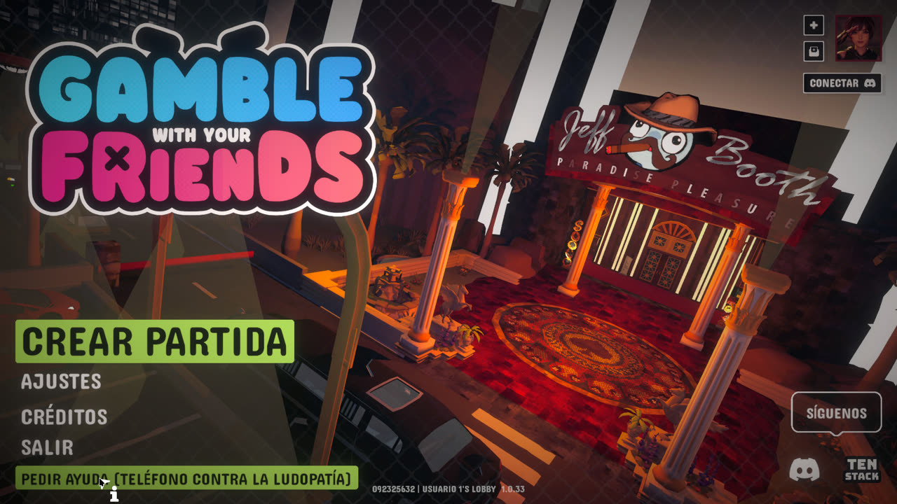

# GWYF Name Hider

Plugin de **cliente** para *Gamble With Your Friends* que muestra los nombres de los
jugadores como **Usuario 1**, **Usuario 2**, etc. en lugar del nombre real de Steam.

Sustituye tanto la etiqueta que se ve **sobre la cabeza** como los nombres en los
menús: lobby, historial de dinero, textos flotantes, pantalla de fin de partida,
gráfica de beneficios, créditos, menú Escape (lista de voz) y lista de miembros.

El cambio es **solo visual y solo en tu cliente**. No modifica la red, ni Mirror, ni
Steam, ni el websocket, y los demás jugadores siguen viendo los nombres reales.



---

## Instalación

Descarga **`GambleWithYourFriends-NameHider-BepInEx6.zip`** desde la pestaña
[Releases](../../releases/latest) (si ya lo tienes, sáltate este paso). El zip ya
incluye BepInEx 6 (build 791, Unity Mono x64) y el plugin.

### Windows

1. Cierra el juego.
2. Extrae **todo** el contenido del zip en la carpeta del juego, junto a
   `Gamble With Your Friends.exe`:

   ```
   ...\steamapps\common\Gamble With Your Friends\
   ```

3. Inicia el juego con normalidad.

Debe quedar así:

```
Gamble With Your Friends.exe
winhttp.dll
doorstop_config.ini
.doorstop_version
BepInEx\
    core\
    plugins\GwyfNameHider\GwyfNameHider.dll
```

### Linux / Steam Deck (Proton)

1. Extrae el zip en `.../steamapps/common/Gamble With Your Friends/`.
2. En Steam: **Propiedades → Opciones de lanzamiento**:

   ```
   WINEDLLOVERRIDES="winhttp=n,b" %command%
   ```

3. Inicia el juego.

Si ya tenías BepInEx 6 por otro mod, puedes copiar solo
`BepInEx/plugins/GwyfNameHider/` y no tocar el resto.

---

## Uso

### Menú de ajustes

En **Ajustes** hay una fila nueva en la pestaña que se abre por defecto (**General**):

- Español: **Ocultar nombres de jugadores**
- Inglés: **Hide player names**

Es un desplegable **Sí / No** (el juego representa así sus ajustes booleanos). El
estado se guarda en la configuración del plugin y se mantiene entre partidas.

### Atajos

| Tecla | Acción |
| --- | --- |
| `F10` | Activa/desactiva la sustitución (restaura los nombres reales al desactivar) |
| `F11` | Vuelca al log los textos visibles y la tabla de alias |

Si el menú de ajustes está abierto, `F10` actualiza también la fila.

---

## Numeración

- **Usuario 1 es siempre el anfitrión** del lobby.
- El resto recibe números **por orden de unión**.
- Los números son **estables**: si alguien se va, los demás conservan el suyo y los
  nuevos reciben el siguiente número (no se reutilizan).
- Al cambiar de lobby la numeración se reinicia.
- Si el anfitrión cambia (migración de host), el nuevo anfitrión pasa a Usuario 1.
- **Tu propio nombre también se sustituye.**

---

## Configuración

Se crea en:

```
BepInEx/config/com.archi.gwyf.namehider.cfg
```

| Sección | Opción | Por defecto | Descripción |
| --- | --- | --- | --- |
| General | `Enabled` | `true` | Activa la sustitución al iniciar |
| General | `AliasFormat` | `Usuario {0}` | Formato del alias; debe contener `{0}` |
| General | `MinNameLength` | `2` | Longitud mínima del nombre real a sustituir |
| General | `SkipDebugUI` | `true` | No tocar consolas/paneles de debug |
| General | `VerboseLog` | `false` | Registrar cada detección y alias en el log |
| Rendimiento | `RescanIntervalFrames` | `15` | Cada cuántos frames se buscan textos nuevos |
| Atajos | `ToggleKey` | `F10` | Tecla para activar/desactivar (vacío = sin atajo) |
| Atajos | `DumpKey` | `F11` | Tecla para volcar textos (vacío = sin atajo) |
| Menu | `Enabled` | `true` | Mostrar la fila en el menú de ajustes |
| Menu | `Label` | *(vacío)* | Texto de la fila; vacío = automático (español/inglés) |
| Menu | `Tab` | *(vacío)* | Pestaña donde ponerla; vacío = la que se abre por defecto |

Ejemplos de `AliasFormat`: `Jugador {0}`, `Anon {0}`, `P{0}`.

Los cambios se aplican al reiniciar el juego, salvo `Enabled`, que también cambia al
instante desde el menú o con `F10`.

---

## Log

El plugin escribe su propio registro en:

```
BepInEx/GwyfNameHider.log
```

El log general de BepInEx (`BepInEx/LogOutput.log`) puede dejar de actualizarse bajo
Proton después de arrancar Unity; por eso existe el archivo propio. Al activar
`VerboseLog` se registran también los alias asignados y los errores de cada parche.

---

## Compatibilidad y límites

- Funciona con BepInEx 6 (Unity Mono x64), el mismo cargador que usan los mods
  actuales del juego; se puede combinar con ellos.
- Los mods antiguos de **BepInEx 5** (Casino Menu, No Pit Stops, All Cosmetics
  Unlocked, Split With Friends) no son compatibles con esta versión del juego.
- El plugin no cambia tu nombre en Steam ni lo que ven los demás jugadores.
- Si dos jugadores tienen exactamente el mismo nombre de Steam, los textos que solo
  llevan el nombre (sin SteamID) usarán el primero; los que llevan SteamID —la
  mayoría— se resuelven correctamente.
- Nombres de menos de `MinNameLength` caracteres no se sustituyen por defecto, para
  evitar reemplazos accidentales dentro de otras palabras.
- Si una actualización del juego cambia los métodos internos, los parches que ya no
  existan se omiten y el "scrubber" genérico sigue tapando la mayoría de textos.
  Revisa `GwyfNameHider.log` para ver qué parches se aplicaron.

---

## Desinstalación

1. Borra `BepInEx/plugins/GwyfNameHider/`.
2. Si no usas ningún otro mod, borra también `BepInEx`, `winhttp.dll`,
   `doorstop_config.ini` y `.doorstop_version`.

---

## Compilar desde el código

Requisitos:

- .NET SDK 8 o superior.
- El juego instalado (para referenciar `Assembly-CSharp.dll` y las DLL de Unity).
- BepInEx 6 instalado en la carpeta del juego (para `BepInEx/core`).

```bash
./scripts/build.sh
# o indicando la ruta del juego:
GAME_DIR="/ruta/a/Gamble With Your Friends" ./scripts/build.sh
```

Para generar el zip instalable hace falta el zip oficial de BepInEx 6 build 791:

```bash
BEPINEX_ZIP="/ruta/BepInEx_win_x64_6.0.0-be.791.zip" ./scripts/package.sh
# -> dist/GambleWithYourFriends-NameHider-BepInEx6.zip
```

O guarda el zip en `vendor/` (esa carpeta no se sube al repositorio). Consulta
[`docs/TECNICO.md`](docs/TECNICO.md) para la arquitectura y la lista de parches.

---

## Licencias

- **GwyfNameHider**: MIT. Ver [`LICENSE`](LICENSE).
- **BepInEx 6**: LGPL-2.1. Copyright (C) BepInEx Team.
  Ver [`third_party/LICENSE-BepInEx.txt`](third_party/LICENSE-BepInEx.txt).
- **Harmony**, **Mono.Cecil**, **MonoMod** y **Unity Doorstop**: ver
  [`THIRD-PARTY.md`](THIRD-PARTY.md).

Este proyecto no está afiliado a TENSTACK ni a los desarrolladores del juego.
